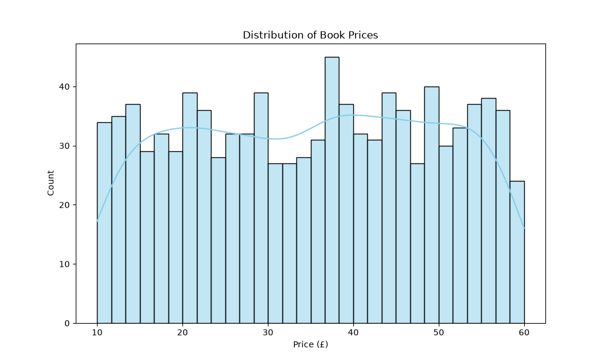

# 📚 Books to Scrape & Market Analyzer

A robust Python web scraping and data analysis tool that extracts book details from [Books to Scrape](http://books.toscrape.com/), processes the dataset using Pandas, and generates market insights and visual charts.

## 🚀 Features
- **Automated Scraping:** Uses `requests` and `BeautifulSoup` to navigate through multiple pages (Pagination) and extract book titles, prices, ratings, and stock status.
- **Data Cleaning & Analysis:** Cleans currency formats and computes summary statistics (average, max, min prices, and rating distributions) using `Pandas`.
- **Data Visualization:** Generates and saves a price distribution histogram using `Seaborn` and `Matplotlib`.
- **Excel Export:** Exports the final clean dataset directly to an Excel file (`books_data.xlsx`).

## 🛠️ Built With
- **Python 3.x**
- **BeautifulSoup4 & Requests** (Web Scraping)
- **Pandas** (Data Processing)
- **Matplotlib & Seaborn** (Data Visualization)

## 📊 Results Preview


## ⚙️ How to Run
1. Clone the repository:
   ```bash
   git clone [https://github.com/karamsjelnjjar-cloud/books-market-analyzer.git](https://github.com/karamsjelnjjar-cloud/books-market-analyzer.git)
